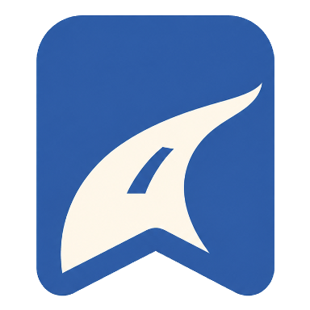

# DRIVELOG



**차 안에서 기억하고 싶은 순간을 남기고, 도착 후 짧은 영상으로 다시 보는 드라이브 기록 앱입니다.** 함께 웃었던 대화나 터널 끝에서 처음 본 바다를 주행 중 표시해 두고, 주차한 뒤 그날의 타임라인을 다시 열어보는 경험을 만듭니다. 이 저장소에는 Pleos Connect용 차량 앱, 동승자 웹 예제, Android 스토리 공유 앱이 있습니다.

## 우리가 만들고 싶은 경험

- **여행에 집중하기.** 이동 중에는 기억하고 싶은 순간만 표시하고, 상세 기록과 영상은 주차한 뒤 확인합니다.
- **같이 탄 사람의 기억도 담기.** 음성 요청과 동승자 표시를 같은 드라이브의 타임라인에 모으는 흐름을 설계했습니다. 현재 차량 앱에서는 두 입력을 디버그 이벤트로 시연할 수 있습니다.
- **기록의 범위를 직접 정하기.** 탑승자 동의와 자동 기록, 위치 연결, AI 분석을 설정에서 관리합니다. 연결된 운행에서 볼 수 있는 클립은 서버가 전달하는 동의 및 처리 상태에 따릅니다.

## 로고와 화면 디자인

**굽은 도로를 담은 북마크**는 함께 달린 길과 “방금 그거 남겨줘”라고 말해 기억하고 싶은 순간을 표시하는 기능을 뜻합니다. 런처와 앱 헤더에서 같은 심볼을 사용합니다.

| 색 | HEX | 화면에서의 역할 |
| --- | --- | --- |
| 버터 크림 | `#FFF8E9` | 앱과 런처 아이콘의 배경 |
| 맑은 블루 | `#2F5EA8` | 북마크, 주요 버튼, 선택 상태, 기록 시연 파형 |
| 살구 | `#FFBC98` | 주차 홈의 기록 일시 중지 영역 |
| 차콜 | `#202A38` | 제목과 본문 |

주차 홈은 **오늘 남긴 순간**과 타임라인을 중심으로 구성합니다. 오늘 기록이 비어 있으면 최근 드라이브와 **지난 기록 보기**를 보여줍니다. 홈 제목에는 나눔명조 Bold, 로고 옆 영문과 큰 숫자에는 Manrope Bold, 본문과 버튼에는 Noto Sans KR을 사용합니다.

쇼츠 목록은 카드 전체가 상세 화면으로 이어지고 오른쪽 끝의 화살표가 이동을 안내합니다. 넓은 창에서는 제목 옆에 출발지와 목적지를 표시하며, 좁은 창에서는 경로를 제목 아래에 배치합니다. 장소는 서버가 제공한 값을 사용합니다.

## 구현 범위

| 흐름 | 현재 차량 앱에서 할 수 있는 일 |
| --- | --- |
| 주차 중 준비 | 탑승자 동의, 자동 기록, 위치 연결, AI 분석 설정을 기기에 저장 |
| 로컬 주행 시연 | **녹음 시연 중** 화면의 파형과 **방금 장면 쇼츠 요청** 버튼으로 순간 표시. 음성 요청과 동승자 표시도 디버그 이벤트로 입력 |
| 로컬 결과 확인 | 오늘과 지난 기록 탐색, 순간 제목 수정, 세션 종료 후 시연 결과 확인. 요청 시각 기준으로 최대 60초 전부터 10초 후까지의 탐색 범위 표시 |
| 연결된 운행 | 팀 BFF로 내 운행과 타임라인 조회, 동의가 적용된 완성 클립 미리보기, 보관한 MP4의 휴대폰 저장 QR 열기 |

로컬 시연은 실제 음성을 수집하지 않습니다. 파형은 애니메이션이며, 로컬 결과는 시연용 이미지와 탐색 범위로 구성됩니다. 연결된 운행에서는 서버가 제공한 MP4를 재생합니다. 실제 Gleo 입력, 차량 위치 및 자동 세션 신호, 빌트인 캠 원본 수집, 음성 전사와 쇼츠 생성은 별도 연동 범위입니다.

## 기술 스택

| 영역 | 사용 기술 |
| --- | --- |
| 차량 앱 | Kotlin 2.2.10, Jetpack Compose, Material 3 1.3.1 |
| 차량 실행 환경 | Pleos Connect v2.1.0 에뮬레이터, Android Automotive OS의 `CarUxRestrictions` |
| 상태와 저장 | AndroidX ViewModel, Compose 상태, SharedPreferences에 설정과 로컬 타임라인 메타데이터 저장 |
| 서버 연결 | Kotlin Coroutines, `HttpsURLConnection`, HTTPS JSON API 및 Bearer 세션 토큰 |
| 영상과 QR | Android `VideoView`로 서버 MP4 미리보기, 서버가 발급한 QR 이미지 표시 |
| 빌드 | Gradle Wrapper 9.3.1, Android Gradle Plugin 9.1.1, JDK 21, Java/Kotlin JVM 대상 17, `compileSdk`·`targetSdk` 35, `minSdk` 28 |

## 빌드 및 실행

JDK 21, Android SDK Platform 35, SDK Build Tools와 Platform Tools를 준비합니다. 차량 실행에는 Device Manager에 등록된 [Pleos Connect v2.1.0 전용 API 34 에뮬레이터](https://document.pleos.ai/docs/connect/guide/getting-started/application-development/setup-connect-sdk-emulator)가 필요합니다.

```sh
./gradlew :app:assembleDebug :app:lintDebug
```

APK는 `app/build/outputs/apk/debug/app-debug.apk`에 생성됩니다. macOS에서는 다음 명령으로 현재 소스를 빌드하고 Pleos에 설치한 뒤 앱을 실행할 수 있습니다. AVD 이름이 다르면 첫 번째 인자로 전달합니다.

```sh
./scripts/run-emulator.sh
```

## MVP 시연

1. Pleos에서 **DRIVELOG**를 열고 **탑승자 동의 확인**, **자동 기록**, **AI 분석**을 켠 뒤 저장합니다. 위치 연결을 끈 상태에서도 순간을 표시할 수 있습니다.
2. 차량이 주차된 상태에서 아래 `drive` 이벤트를 보내고 **방금 장면 쇼츠 요청**을 누릅니다. `mark` 이벤트로 음성 요청도 시연할 수 있습니다.
3. `park` 이벤트를 보내 주차 홈으로 돌아온 다음 타임라인을 확인합니다. **세션 종료**를 확정하면 시연 항목이 **생성 중 → 완성 · 시연** 순으로 바뀝니다. AI 분석을 끈 경우에는 **원본 대기**로 표시됩니다.

```sh
adb shell am broadcast --user current -a kr.drivelog.app.DEMO -p kr.drivelog.app --es event drive
adb shell am broadcast --user current -a kr.drivelog.app.DEMO -p kr.drivelog.app --es event mark --es request_id demo-1 --es instruction '웃는 데까지'
adb shell am broadcast --user current -a kr.drivelog.app.DEMO -p kr.drivelog.app --es event park
```

위 명령은 디버그 APK의 화면을 연 상태에서 실행합니다. 여러 기기가 연결돼 있으면 `adb -s <기기 ID>`를 사용합니다. 같은 `request_id`의 표시 이벤트는 한 번만 기록됩니다. `occupants_changed` 이벤트를 보내면 기록이 일시 중지되고, 주차 중 탑승자 동의를 다시 확인한 뒤 계속할 수 있습니다.

실제 차량에서 주행 제한이 활성화되거나 차량 상태를 확인할 수 없으면 시연 파형, 수동 요청 버튼, 설정과 편집에 대한 접근을 제한합니다.

## 연결된 드라이브

주차 홈의 **운행 연결**에서 팀 BFF의 HTTPS 주소와 로그인 세션 토큰을 입력합니다. 연결 후 **내 운행**에서 서버에 등록된 운행과 보관함을 열 수 있습니다. BFF는 로그인한 사용자에게 해당하는 개인 토큰으로 요청을 전달하며, 앱은 세션 토큰을 메모리에만 유지합니다. 디버그 APK에서는 운영 주소에 테스트 계정의 개인 토큰을 사용해 연결을 확인할 수 있습니다.

| 기능 | API |
| --- | --- |
| 연결 확인 | `GET /api/status` |
| 내 운행과 타임라인 | `GET /api/private-trips`, `GET /api/private-trips/{id}/timeline` |
| 음성·탭 표시 | `PUT /api/private-trips/{id}/voice-marks/{markId}`, `PUT /api/private-trips/{id}/marks/{markId}` |
| 완성 클립 미리보기 | `GET /api/private-trips/{id}/marks/{markId}/clip` |
| 보관 목록·영상·휴대폰 저장 QR | `GET /api/library`, `GET /api/library/{id}/clip`, `POST /api/library/{id}/handoffs` |

시연 중 **방금 장면 쇼츠 요청**은 선택한 서버 운행이 주행 중이면 탭 표시를 전송하고, 그 외에는 로컬 시연 타임라인에 수동 요청을 남깁니다. 디버그 이벤트 `server_voice_mark`와 `server_passenger_mark`도 선택한 서버 운행에 표시를 전송합니다. `request_id`를 지정하려면 UUID를 사용합니다. 전송 대기 상태에서는 **표시 다시 보내기**가 같은 ID와 본문을 사용합니다.

출발지와 목적지를 표시하려면 BFF가 타임라인 응답과 보관함 항목에 `driveContext: { departure, destination }`를 제공해야 합니다. 두 값은 위치 맥락 제공이 허용된 운행의 지명이며, 경로가 없는 기록에는 **경로 정보 없음**이 표시됩니다. 계정 발급, 운영자 출발·도착 등록, 탑승자·보호자 동의, 원본 업로드, 편집 작업과 확정은 팀 서버 흐름에서 처리합니다.

## 음성 표시와 휴대폰 공유

**운행 연결 → 음성 표시 연동**에서 배정받은 주행 ID와 개인 토큰으로 연결합니다. 기기에 연결된 음성 인식기를 통해 순간을 표시하며, 서버가 요청을 수락하면 TTS로 응답합니다. 동승자 표시와 타임라인 예제는 [passenger-web](passenger-web/README.md)에 있습니다.

Android 9 이상에서 `./gradlew :phone:assembleDebug`로 빌드한 `phone/build/outputs/apk/debug/phone-debug.apk`와 Instagram을 설치합니다. DriveLog 스토리 앱에 프로젝트의 공개 Meta 앱 ID를 입력하거나 빌드 시 `-PdriveLogMetaAppId=숫자ID`를 지정합니다.

차량 또는 개인 보관함의 QR을 Android Chrome으로 스캔하고 **인스타 스토리에 공유**를 누릅니다. 선택한 MP4는 Instagram 작성기로 전달되며, 게시는 사용자가 작성기에서 완료합니다. 전송 중 QR이 소진된 경우 새 QR을 발급합니다.

[이전 목업 구현 및 검증 기록](docs/implementation.md)
